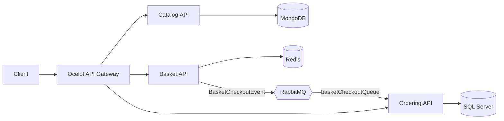

# MicroservicesApp

A small e-commerce backend split into Catalog, Basket and Ordering microservices on ASP.NET Core 3.1, connected through RabbitMQ and fronted by an Ocelot API gateway, all orchestrated with Docker Compose.

> **📦 Archived** — this is an early learning project (2020), kept for reference only. It targets an end-of-life framework and is not maintained.


## Overview

| Service | Storage | Responsibility |
|---|---|---|
| `Catalog.API` | MongoDB | Product CRUD and filtering by category; seeds six sample products |
| `Basket.API` | Redis | Per-user basket; `Checkout` publishes a `BasketCheckoutEvent` to RabbitMQ |
| `Ordering.API` | SQL Server (EF Core) | Consumes checkout events and stores orders via MediatR (CQRS); query orders by user |
| `OcelotAPIGateway` | – | Single entry point routing `/Catalog`, `/Basket` and `/Order` to the services |

## Architecture



`Ordering` follows a clean-architecture split (`Core` → `Application` → `Infrastructure` → `API`), with EF Core migrations applied and sample data seeded at startup.

## Tech stack

- ASP.NET Core 3.1 Web APIs, Swagger (Swashbuckle)
- MongoDB.Driver, StackExchange.Redis, EF Core 5 (SQL Server)
- RabbitMQ.Client, MediatR, AutoMapper, Ocelot 15
- Docker Compose (Visual Studio container tooling)

## Project structure

```
src/
├── ApiGateway/OcelotAPIGateway/   ocelot.json route configuration
├── Catalog/Catalog.API/
├── Basket/Basket.API/
├── Common/EventBusRabbitMQ/       RabbitMQ connection, producer, shared event contract
└── Ordering/
    ├── Ordering.API/              controller, RabbitMQ consumer
    ├── Ordering.Application/      commands, queries, handlers, mapping
    ├── Ordering.Core/             entities, repository interfaces
    └── Ordering.Infrastructure/   OrderContext, migrations, repositories
docker-compose.yml / docker-compose.override.yml
```

## Getting started

Prerequisites: Docker. To run services outside containers you need the [.NET Core 3.1 runtime](https://dotnet.microsoft.com/download/dotnet/3.1) plus local MongoDB, Redis, RabbitMQ and SQL Server.

```bash
docker compose up -d --build
```

| URL | Service |
|---|---|
| http://localhost:7000 | API gateway (`/Catalog`, `/Basket?userName=...`, `/Basket/Checkout`, `/Order?userName=...`) |
| http://localhost:8000/swagger | Catalog API |
| http://localhost:8001/swagger | Basket API |
| http://localhost:8002/swagger | Ordering API |
| http://localhost:15672 | RabbitMQ management (guest/guest) |

## Notes and limitations

- The SQL Server `sa` password in `docker-compose.override.yml` and `Ordering.API/appsettings.json` is a local development value; change it before any shared use.
- The `mcr.microsoft.com/mssql/server` image is amd64-only and may not start on Apple Silicon; Azure SQL Edge works as a drop-in for local testing. On macOS, port 7000 may be taken by AirPlay Receiver.
- Payment details travel in plain text through the event and are stored as-is — demo only.
- No authentication, resilience policies for messaging, or tests.
